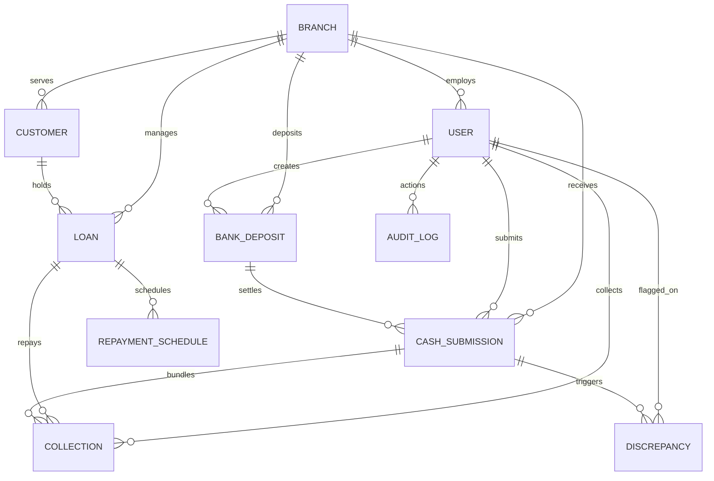

# Cash Management & Reconciliation System (CMRS)

A production-grade **Cash Management & Reconciliation System (CMRS)** designed for lending institutions and fintechs to track, control, and audit the complete lifecycle of cash collections from borrowers through field agents, physical branch vaults, and commercial bank deposits to final corporate settlement.

---

## 1. System Overview & Problem Statement

In microfinance and non-banking financial companies (NBFCs), collection agents operate in the field collecting cash repayments door-to-door. This creates critical operational risks:
- Physical cash holding risks (cash theft, loss, unauthorized delay)
- Branch handover tally discrepancies (shortages and counterfeit currency)
- Bank teller discrepancies vs. slip values
- Lack of single-pane visibility across the funds lifecycle

### The 5-Stage Financial Lifecycle
```
[Customer Repayment]
         │
         ▼ (1. EXPECTED SCHEDULE)
[Field Collection Agent]  ──> Digital Receipt Generated (2. COLLECTED / CASH IN HAND)
         │
         ▼ Batch Handover
[Branch Manager / Vault]  ──> Physical Note Count & Verification (3. BRANCH RECEIVED / RECONCILED)
         │                    (Discrepancy: Shortage / Excess Logged)
         ▼ Bank Challan Slip
[Commercial Bank Deposit] ──> Deposit Slip & Unique UTR (4. BANK DEPOSITED)
         │
         ▼ Statement Match
[Corporate Treasury]      ──> E-Statement Matching & Settlement (5. SETTLED & CLOSED)
```

---

## 2. User Roles & Test Credentials

The system enforces strict Role-Based Access Control (RBAC). For evaluator convenience, the web application includes a **1-click Role Switcher** in the top navigation bar to instantaneously switch between perspectives without manual re-login.

| Role | Username | Password | Full Name & Branch | Scope & Responsibilities |
| :--- | :--- | :--- | :--- | :--- |
| **Super Admin / Finance Controller** | `admin` | `Password@123` | Aditya Mehta (Head Office) | Global access to all branches, vault balances, treasury settlements, write-offs, and compliance audit trail. |
| **Branch Manager (Mumbai)** | `bm_mumbai` | `Password@123` | Vikram Seth (Mumbai Central) | Physical cash verification, approves/rejects agent handovers, logs shortages, creates bank deposit slips. |
| **Branch Manager (Delhi)** | `bm_delhi` | `Password@123` | Sunita Verma (Delhi North) | Manages Delhi North branch vault, initiates bank deposits, resolves branch-level collection discrepancies. |
| **Field Collection Agent** | `agent_rajesh` | `Password@123` | Rajesh Kumar (Mumbai Central) | Collects cash repayments from Mumbai borrowers, issues instant receipts, holds unsubmitted cash, submits batches. |
| **Field Collection Agent** | `agent_amit` | `Password@123` | Amit Patel (Mumbai Central) | Secondary Mumbai field agent. |
| **Field Collection Agent** | `agent_priya` | `Password@123` | Priya Sharma (Delhi North) | Delhi field agent with assigned North Delhi borrowers. |

---

## 3. Technology Stack & Engineering Decisions

| Layer | Technology | Engineering Rationale |
| :--- | :--- | :--- |
| **Backend** | Python 3 + Django 5/6 + Django REST Framework | Mature ORM, ACID-compliant transaction blocks (`@transaction.atomic`), rock-solid security, clean modular structure. |
| **Financial Arithmetic** | Python `Decimal` / SQL `NUMERIC(12, 2)` | **Strict zero-floating-point rule**. Financial calculations must never suffer from IEEE 754 precision drift. |
| **Authentication** | SimpleJWT (JSON Web Tokens) | Stateless, secure bearer token architecture with auto-refresh mechanism. |
| **Database** | PostgreSQL 15 (Docker) / SQLite (Zero-config local fallback) | Robust relational constraints, unique indexes for idempotency, transactional DDL. |
| **API Documentation** | OpenAPI 3.0 via `drf-spectacular` & Swagger UI | Auto-generated interactive documentation with schema exploration and live test sandbox. |
| **Frontend** | React 19 + Vite 6 + Tailwind CSS v4 + Lucide Icons | Ultra-fast compile time, responsive modern UI, instant modal workflows, clean separation of concerns. |
| **Testing** | Pytest + Pytest-Django | Automated unit and integration test suite asserting all required financial business rules. |
| **DevOps** | Docker + Docker Compose | Containerized multi-service spin up (Postgres, Django Backend, React/Nginx Frontend). |

---

## 4. Database Schema & Architecture



### Core Data Models
1. **`Branch`**: Physical location with `code`, `city`, and real-time `vault_cash_balance`.
2. **`User`**: Custom user with `role` (Admin, BM, Agent), assigned `branch`, `employee_id`, and `cash_in_hand`.
3. **`Customer`**: Borrower profile with Aadhaar/PAN national ID, contact details, assigned agent and branch.
4. **`Loan`**: Loan contract with `principal_amount`, `interest_rate`, `tenure_months`, `total_amount_payable`, `total_amount_collected`, and `outstanding_balance`.
5. **`RepaymentSchedule`**: Monthly EMI installment with `installment_number`, `due_date`, `due_amount`, `paid_amount`, and `status` (`PENDING`, `PARTIAL`, `PAID`, `OVERDUE`).
6. **`Collection`**: Individual transaction with unique receipt (`REC-YYYYMMDD-XXXX`), `loan`, `agent`, `amount`, `payment_mode` (`CASH`, `UPI_SANDBOX`), `status`, and `idempotency_key`.
7. **`CashSubmission`**: Agent batch handover to branch with `total_expected_amount`, `total_actual_amount`, `discrepancy_amount`, and approval status.
8. **`Discrepancy`**: Formal audit record of shortages (`SHORTAGE`) or excesses (`EXCESS`), with investigation notes and resolution status.
9. **`BankDeposit`**: Commercial deposit slip with `deposit_slip_number`, `bank_name`, `amount`, unique `bank_reference_number` (UTR), `settled_amount`, and `settlement_variance`.
10. **`AuditLog`**: Append-only log recording actor, action, timestamp, IP address, and payload snapshot.

---

## 5. Important Business Cases & Rules Handled

### 1. Partial Repayment
Borrowers can pay any fraction of their due installment. The system decrements the installment's remaining due amount, sets status to `PARTIAL`, updates the loan's overall `outstanding_balance`, and adjusts the agent's `cash_in_hand` accordingly.

### 2. Over-Collection Prevention
If an agent enters an amount exceeding the loan's total `outstanding_balance`, the API rejects the transaction with `HTTP 400 Bad Request: Over-collection rejected`. If an amount exceeds a single EMI installment, it pays off the current installment and automatically cascades the surplus to future pending installments.

### 3. Duplicate Collection Prevention (Idempotency)
Every collection request generates a unique client token (`idempotency_key`). The database enforces uniqueness on `idempotency_key`, preventing duplicate charge clicks or network retries.

### 4. Cash Discrepancy Handling during Branch Verification
During handover count:
$$\text{Difference} = \text{Actual Cash Counted} - \text{Expected Receipts Sum}$$
- **Example Scenario**: Expected: ₹50,000 | Counted: ₹48,500 | Difference: -₹1,500
- If $\text{Difference} < 0$: System automatically creates a `Discrepancy` of type `SHORTAGE` flagged against the agent.
- If $\text{Difference} > 0$: System logs an `EXCESS` discrepancy for audit review.
- Vault balance increments only by the **actual physical cash received** (₹48,500).

### 5. Rejected Cash Submission
If a Branch Manager detects counterfeit notes, torn bills, or major unverified amounts, they click **Reject Submission** with a mandatory explanation. The submission status transitions to `REJECTED`, and all collections revert to `COLLECTED` status so the cash remains on the agent's ledger for correction.

### 6. Bank Deposit Mismatch
When corporate treasury reconciles the commercial bank statement:
$$\text{Variance} = \text{Settled Credit} - \text{Slip Amount}$$
If the commercial bank credited ₹49,850 on a ₹50,000 challan (e.g., ₹150 teller handling deduction), the deposit status transitions to `SETTLEMENT_MISMATCH` with variance recorded and an alert displayed on the dashboard.

### 7. Duplicate Bank Reference Prevention
To prevent multiple branches claiming the same UTR or re-using old bank challans, `bank_reference_number` is indexed with a `unique=True` database constraint and serializer validator.

### 8. Immutability of Reconciled Financial Transactions
Once a transaction is in `RECONCILED`, `BANK_DEPOSITED`, or `SETTLED` status, direct modifications (`PUT/PATCH`) and deletions (`DELETE`) are strictly forbidden (`HTTP 403 Forbidden`). Financial adjustments must proceed via audited discrepancy resolution or contra entries.

### 9. Failed or Delayed Settlement
Deposits in `DEPOSITED` status pending settlement for over 48 hours trigger a highlighted **Delayed Settlement Alert** on the executive dashboard. Bounced deposits can be marked `FAILED` with failure reasons logged.

### 10. Multi-Channel Payment Sandbox (UPI / QR)
Demonstrates omni-channel reconciliation. When a customer pays via the simulated UPI QR Code, physical cash holding and branch vault steps are bypassed: the payment directly transitions to `SETTLED` in the corporate account, updating loan balances instantaneously.

---

## 6. Quick Start & Setup Instructions

### Option A: Local Development (Fastest, Zero External Dependencies)

#### 1. Backend Setup
```bash
cd backend

# Create and activate virtual environment
python -m venv venv
# On Windows:
.\venv\Scripts\Activate.ps1
# On macOS/Linux:
source venv/bin/activate

# Install dependencies
pip install -r requirements.txt

# Run migrations & seed realistic data
python manage.py migrate
python seed_data.py

# Start Django development server
python manage.py runserver 127.0.0.1:8000
```

#### 2. Frontend Setup
In a new terminal:
```bash
cd frontend

# Install Node dependencies
npm install

# Start Vite React development server
npm run dev
```
Open **`http://localhost:3000`** (or `http://localhost:5173`) in your browser.

---

### Option B: Docker Compose Spin Up

```bash
# From project root directory
docker compose up --build
```
- Frontend UI: `http://localhost:3000`
- Django REST API: `http://localhost:8000/api/`
- Swagger Interactive Docs: `http://localhost:8000/api/docs/`
- PostgreSQL: Port `5432`

---

## 7. Running Automated Tests

Run the complete test suite verifying all 8 business logic workflows:
```bash
cd backend
pytest
```
Expected output:
```
tests/test_cmrs_business_logic.py ........ [100%]
8 passed in ~20s
```

---

## 8. Interactive API Documentation

- **Swagger UI**: `http://localhost:8000/api/docs/`
- **ReDoc UI**: `http://localhost:8000/api/redoc/`
- **OpenAPI Schema (JSON)**: `http://localhost:8000/api/schema/`

### Key REST Endpoints
| Endpoint | Method | Description |
| :--- | :--- | :--- |
| `/api/auth/login/` | `POST` | Authenticate and obtain JWT access & refresh tokens |
| `/api/auth/me/` | `GET` | Get current user role, branch, and cash in hand |
| `/api/dashboard/analytics/` | `GET` | Executive dashboard KPIs, lifecycle funnel, and trends |
| `/api/loans/` | `GET` | List active loans with outstanding balances |
| `/api/loans/{id}/schedules/` | `GET` | Retrieve EMI installment schedule |
| `/api/collections/` | `POST` | Record customer repayment (Cash / UPI) |
| `/api/collections/daily_summary/` | `GET` | Agent daily collection stats & unsubmitted cash |
| `/api/collections/submit_batch/` | `POST` | Agent bundles cash into branch submission packet |
| `/api/submissions/{id}/reconcile/` | `POST` | Branch Manager counts cash, logs discrepancy, accepts into vault |
| `/api/submissions/{id}/reject/` | `POST` | Branch Manager rejects submission back to agent |
| `/api/bank-deposits/` | `POST` | Create bank deposit slip against vault cash |
| `/api/bank-deposits/{id}/settle/` | `POST` | Match bank statement credit & verify UTR settlement |
| `/api/discrepancies/` | `GET` | Audit trail of shortages and excesses |
| `/api/discrepancies/{id}/resolve/` | `POST` | Resolve discrepancy (recovery / write-off) |
| `/api/audit-logs/` | `GET` | Immutable system audit log entries |

---

## 9. 5-Minute Video Explanation Script & Outline

This script is structured for the mandatory 5-minute explanation video:

### [0:00 - 0:45] Problem Understanding & Scope
- "Hello, today I am presenting the Cash Management & Reconciliation System (CMRS). In field lending operations, cash collected by door-to-door agents introduces significant reconciliation blindspots between the field, branch vaults, and commercial banks."
- "CMRS tracks every rupee across the complete 5-stage lifecycle: **Expected Schedule → Agent Collected → Branch Received & Verified → Bank Deposited → Corporate Settled**."

### [0:45 - 1:30] System Architecture & Technology Choices
- "For the backend, we chose **Python, Django, and Django REST Framework** because of ACID transaction guarantees (`@transaction.atomic`) and the battle-tested ORM."
- "Crucially, for monetary values, **we strictly use Python's `Decimal` type and SQL `NUMERIC(12,2)`** to prevent floating-point calculation inaccuracies."
- "On the frontend, we built a modern React application with Vite, Tailwind CSS, and Lucide icons, complete with an **instant Role Switcher** to seamlessly evaluate different operational roles."

### [1:30 - 2:45] Database Design & Key Workflows Walkthrough
- "Our schema establishes clean separation of concerns: `Customer` and `Loan` maintain repayment schedules and outstanding balances."
- "When an agent collects cash, a `Collection` is created with a unique receipt number (`REC-...`) and an `idempotency_key` to prevent duplicate submissions."
- "The agent bundles cash into a `CashSubmission`. The Branch Manager performs a physical note count. If expected is ₹50,000 but actual cash received is ₹48,500, the system automatically logs a **₹1,500 Shortage Discrepancy**, records branch notes, and increments the vault balance by exactly ₹48,500."
- "From the vault, the Branch Manager creates a `BankDeposit` with a unique UTR. Finally, treasury verifies the commercial bank statement, triggering `SETTLED` or highlighting a `SETTLEMENT_MISMATCH`."

### [2:45 - 3:45] Key Business Edge Cases Handled
- "We specifically handled 10 core business edge cases:
  1. **Partial Repayments**: Updates EMI schedule status and decrements balance.
  2. **Over-collection Prevention**: Guaranteed balance caps.
  3. **Duplicate Prevention**: Enforced via unique idempotency keys and bank references.
  4. **Rejected Submissions**: Seamlessly rolls back collections so cash stays on the agent's ledger.
  5. **Transaction Immutability**: Reconciled and settled transactions are locked against unauthorized edits.
  6. **Multi-Channel Sandbox**: Simulated UPI repayments demonstrate digital straight-through settlement."

### [3:45 - 4:30] Live Application Demonstration
- "Demonstrating the Executive Dashboard: Viewing the 8 financial KPIs and the visual lifecycle funnel."
- "Switching to Field Agent Rajesh: Recording an EMI repayment for borrower Ramesh Yadav, issuing a printable receipt, and submitting the batch to Mumbai Central."
- "Switching to Branch Manager Vikram: Verifying the pending packet, demonstrating the live difference calculator, approving into vault, and generating an HDFC Bank deposit slip."
- "Switching to Super Admin: Reconciling bank statements and closing the settlement loop."

### [4:30 - 5:00] Trade-Offs & Future Improvements
- "Trade-offs: We prioritized rigorous financial data integrity, idempotency, and clean role isolation over building an unnecessarily bloated codebase."
- "With more time, I would integrate:
  1. Live SMS/WhatsApp receipt delivery via Twilio/Gupshup.
  2. GPS location tagging for field collections.
  3. Automated bank statement parsing via Open Banking APIs (Account Aggregator)."

---

## 10. Environment Variables Documentation

| Variable | Default Value | Description |
| :--- | :--- | :--- |
| `SECRET_KEY` | `django-insecure-cmrs-production-grade...` | Cryptographic signing key for Django |
| `DEBUG` | `True` | Debug mode (`True` for local, `False` for production) |
| `DB_ENGINE` | `sqlite` | Database engine (`sqlite` or `postgresql`) |
| `POSTGRES_DB` | `cmrs_db` | PostgreSQL database name |
| `POSTGRES_USER` | `postgres` | PostgreSQL username |
| `POSTGRES_PASSWORD` | `postgrespassword` | PostgreSQL password |
| `POSTGRES_HOST` | `localhost` (or `db` in Docker) | Database hostname |
| `POSTGRES_PORT` | `5432` | Database port |
